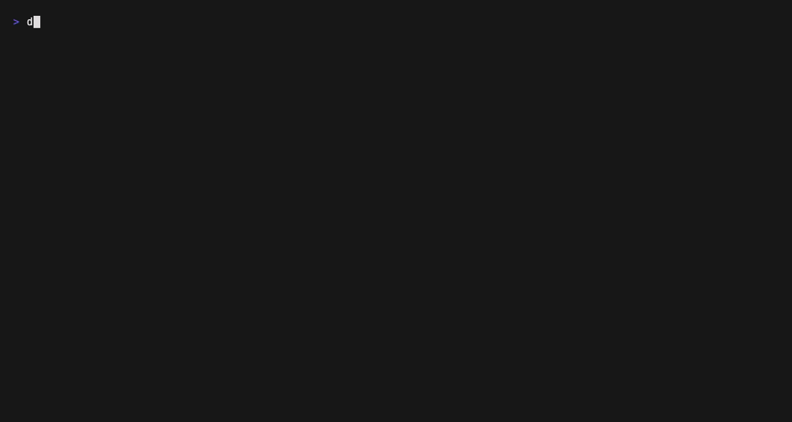

# dependency-dir-analyzer

A small, fast cross-platform CLI that scans a directory tree for **dependency
directories** — the folders package managers and build tools generate and that
can usually be regenerated from source (`node_modules`, `target`, `.venv`,
`vendor`, `.gradle`, …) — and shows how much disk space they use and when each
was last touched.

Great for answering "where did all my disk space go?" and for finding
reclaimable space across a folder full of projects.

The binary is called **`dda`**. Install it with Homebrew:

```bash
brew install hco/tap/dda
```



## Features

- **Interactive, live-updating TUI** — results stream in and re-sort as the
  scan runs; you don't wait for it to finish. Scroll, re-sort, group by
  ecosystem, and filter by size or age.
- **Reclaim space safely** — mark the directories you want gone (one at a time,
  a whole ecosystem, or everything visible), watch the total to-be-freed size
  add up, then delete them after a confirmation step.
- **What deleting actually frees** — sizes count disk blocks, not file
  lengths, and leave out what is shared with other projects via hardlinks or
  APFS clones (as pnpm does), so a `node_modules` that is mostly a view of the
  pnpm store doesn't promise space it can't give back. Toggle to the on-disk
  size any time. See [How sizes are measured](#how-sizes-are-measured).
- **pnpm stores** — the stores your projects install from are listed too, and
  deleting one prunes it (`pnpm store prune`) unless you ask for the whole
  store to go.
- **Size _and_ last-modified time** — stale directories (good cleanup
  candidates) are colour-coded by age, so you can tell a six-month-old
  `node_modules` from one you built this morning.
- **Fast** — a parallel filesystem walk (via `rayon`) that sizes each matched
  subtree once and never descends into it twice.
- **Scriptable output** — `--format json` or `--format csv` for piping into
  other tools.
- **Shell completions** for bash, zsh, fish, PowerShell and elvish.

## Example

On a terminal, `dda` opens the interactive view shown above: results stream in
and re-sort as the scan runs, you mark what you want gone, and a confirmation
step shows the space it frees before anything is deleted.

Piped or redirected, it prints a plain aligned table instead:

```console
$ dda ~/code | cat
1.2 GB    2d ago   Node.js          /home/me/code/web-app/node_modules
420 MB    5mo ago  Rust / Maven     /home/me/code/cli-tool/target
180 MB    1y ago   Python (venv)    /home/me/code/ml/.venv
 36 MB    3w ago   Go / PHP / Ruby  /home/me/code/api/vendor

1.84 GB freeable across 4 directories (1.91 GB on disk, 52831 files)
```

## Usage

```text
Usage: dda [OPTIONS] [PATH]
       dda completions <SHELL>

Arguments:
  [PATH]  Root directory to scan [default: .]

Options:
  -f, --format <FORMAT>        Output format [default: table] [possible values: table, json, csv]
  -m, --min-size <SIZE>        Only report directories at least this large (e.g. 10MB, 1.5GB, 500K)
  -t, --top <TOP>              Show at most this many results (largest first); 0 = no limit [default: 0]
      --follow-symlinks        Follow symbolic links while scanning
      --icons <STYLE>          Ecosystem icon style in the interactive UI [possible values: off, emoji, nerd]
      --size-mode <MODE>       Size to show and sort by [possible values: freeable, allocated]
      --no-pnpm-default-store  Only list pnpm stores that a scanned project uses
      --plain                  Print a plain static table instead of the interactive TUI
      --no-mouse               Disable mouse capture in the interactive UI
      --no-summary             Do not print the summary footer (non-interactive output)
  -h, --help                   Print help
  -V, --version                Print version
```

The interactive TUI is used automatically when the default `table` format
writes to a terminal. It falls back to the plain table when the output is piped
or redirected, or when you pass `--plain`. `--format json` and `--format csv`
are always non-interactive.

`--size-mode` picks which size the table shows, sorts by and applies
`--min-size` to: `freeable` (the default) or `allocated` (on disk). In the TUI
it overrides the remembered choice for that run.

### TUI keys

| Key                  | Action                                      |
| -------------------- | ------------------------------------------- |
| `↑` / `↓`, `j` / `k` | Move the cursor                             |
| `PgUp` / `PgDn`      | Jump a page                                 |
| `Home` / `End`       | Jump to the first / last row                |
| `S`                  | Cycle sort (size → modified → name → files) |
| `f`                  | Toggle the size shown (freeable ↔ on disk)  |
| `u`                  | Toggle size units (MB ↔ auto)               |
| `i`                  | Cycle ecosystem icons (emoji → nerd → off)  |
| `g`                  | Toggle grouping by ecosystem                |
| `Enter`              | Fold / unfold the selected group            |
| `s`                  | Cycle the minimum-size filter               |
| `a`                  | Cycle the "modified older than" filter      |
| `e`                  | Open the ecosystem filter (multi-select)    |
| `r`                  | Reset all filters and grouping              |
| `Space` / `x`        | Mark / unmark for deletion (a whole group on a header) |
| `A`                  | Mark / unmark all visible directories       |
| `c`                  | Clear the selection                         |
| `d` / `Del`          | Delete marked directories (asks to confirm) |
| `p`                  | pnpm stores: prune (default) ↔ delete whole |
| `?`                  | Toggle the keyboard-shortcuts help          |
| `q` / `Esc`          | Quit                                        |

When you press `d`, a confirmation dialog lists what will be removed and the
space it frees; press `y` to confirm or `Esc` to cancel. Deletion is
**permanent** — directories are removed right away, not moved to the system
trash. They are dependency directories, so your package manager or build tool
can regenerate them. The space shown is always the freeable size, whichever
size the table displays.

A marked **pnpm store** is pruned by default (`pnpm store prune`): only
packages no project references anymore are removed, so nothing has to be
downloaded again. Marked projects are deleted first, so the prune also drops
what only they were using. Press `p` (or click the `store:` chip) to delete the
whole store instead; the confirmation dialog names the action per store, and
the choice is remembered. dda runs the installed `pnpm` when it reads that
store's layout (`v10` → pnpm 10, `v3` → pnpm 7–9) and `npx pnpm@<major>`
otherwise. If that fails, the footer shows the command to run yourself.

### Mouse

The TUI also responds to the mouse: the **scroll wheel** moves the selection, a
**left click** highlights the row under the cursor, and the header filter chips,
footer status chips (show / sort / group / unit / icons / store) and overlay controls are all
**clickable** — each bound to the same action as its key.

Capturing the mouse suppresses the terminal's own click-drag text selection and
scrollback while the TUI runs (hold `Shift` to bypass in most terminals). To
turn capture off, use any of — in priority order — the `--no-mouse` flag, the
`DDA_NO_MOUSE` environment variable (`1`/`true` to disable, `0`/`false` to force
on), or the persisted `mouse` setting in the view-state file.

Examples:

```bash
dda                       # interactively scan the current directory
dda ~/code --top 10       # the 10 biggest dependency dirs under ~/code
dda . --min-size 100MB    # only directories ≥ 100 MB
dda . --format json | jq  # machine-readable JSON
dda . --format csv > out.csv  # machine-readable CSV
```

## Shell completions

Generate a completion script with `dda completions <shell>` and install it
where your shell looks for completions:

```bash
# bash
dda completions bash | sudo tee /etc/bash_completion.d/dda > /dev/null

# zsh (somewhere on your $fpath)
dda completions zsh > "${fpath[1]}/_dda"

# fish
dda completions fish > ~/.config/fish/completions/dda.fish
```

`powershell` and `elvish` are supported too.

## Detected directories

`node_modules`, `bower_components`, `.next`, `.nuxt`, `.svelte-kit`, `.angular`,
`target`, `.venv`, `venv`, `__pycache__`, `.tox`, `.mypy_cache`, `.pytest_cache`,
`vendor`, `.bundle`, `.gradle`, `.dart_tool`, `elm-stuff`, `Pods`, `.terraform`,
`DerivedData`, `.cargo`, `.cache`.

When a directory matches, its whole subtree is sized as one unit and the scanner
does not descend further, so nested matches are never double-counted.

## How sizes are measured

dda reports two sizes per directory:

- **On disk** (`allocated_bytes`) — the blocks the files occupy, like `du`. A
  file hardlinked several times inside the directory counts once.
- **Freeable** (`freeable_bytes`) — what deleting the directory would actually
  give back. A file that is also reachable from outside the directory, through
  a hardlink (pnpm on Linux) or as an APFS clone (pnpm on macOS) whose other
  copies live elsewhere, stays on disk after the delete and is not counted.
  Clones are tracked per file with APFS's clone id and reference count (macOS
  only; other volumes treat every file as its own). On Windows dda can't tell
  hardlinks apart, so every file counts as the directory's own and freeable
  equals on disk; pnpm's hardlinked `node_modules` look fully freeable there.

On macOS, dda reads each directory's file sizes, link counts and clone ids
in bulk with `getattrlistbulk`, so this costs no more time than summing plain
file lengths. Volumes that don't support it, and `--follow-symlinks`, fall
back to one call per file.

The TUI and plain table show **freeable** by default; `f` or `--size-mode
allocated` switches to on disk. Rows marked `⇄` are mostly shared: deleting
them frees less than half of what they occupy. Summed totals are a guide, not
an exact figure: two projects sharing the same packages each count those as
not freeable, even though deleting both would free them.

### pnpm stores

pnpm keeps one store of packages per machine and clones or hardlinks them into
every project's `node_modules`. dda reads each `node_modules/.modules.yaml` to
find the stores in use and lists each one once (including pnpm's default
location, unless `--no-pnpm-default-store` or the `pnpm_default_store`
setting turns that off). A store's freeable size is roughly what
`pnpm store prune` can reclaim: packages no project points at anymore.

### Time Machine snapshots

On macOS, local Time Machine snapshots keep a copy of everything on the volume
as it was when the snapshot was taken. Deleted files stay on disk until every
snapshot that includes them has expired (usually within 24 hours), so free space
may not grow right away. Snapshots cover the whole volume; no folder can be
excluded from them (`tmutil addexclusion` only affects backups). dda ignores
snapshots when measuring and shows a reminder in the footer when any exist.

### JSON and CSV fields

Every directory has `path`, `ecosystem`, `name`, `kind` (`dependency` or
`pnpm_store`), `allocated_bytes`, `freeable_bytes`, `file_count` and its
modification time (`modified` in JSON as `{unix, rfc3339}`;
`modified_unix` / `modified_rfc3339` in CSV). JSON also carries
`total_allocated_bytes`, `total_freeable_bytes`, `total_file_count` and
`directory_count`. Both formats always contain both sizes, whatever
`--size-mode` is set to; the mode only decides the sort order and what
`--min-size` applies to.

## Install

### Homebrew (macOS / Linux)

```bash
brew install hco/tap/dda
```

### From a release

Download the archive for your platform from the
[Releases](../../releases) page, extract it, and put `dda` on your `PATH`.
Each archive ships alongside a SHA-256 checksum.

### From source

```bash
cargo install --path .
# or, with mise:
mise run install
```

## Development

This project uses [mise](https://mise.jdx.dev) to manage the Rust toolchain and
as a task runner.

```bash
mise install      # install the pinned Rust toolchain
mise run build    # build
mise run test     # run tests
mise run ci       # fmt-check + lint + test + release build (mirrors CI)
mise tasks        # list all tasks
```

The demo GIF at the top is rendered with [VHS](https://github.com/charmbracelet/vhs)
from [`demo/demo.tape`](demo/demo.tape). Regenerate it with `mise run demo`,
which builds the release binary, generates a throwaway fake project tree
(`demo/make-fixture.sh`, not committed), then records the GIF. This needs `vhs`
(pinned in `mise.toml`) plus `ttyd` and `ffmpeg` on `PATH` (`brew install ttyd ffmpeg`).

See [CLAUDE.md](CLAUDE.md) for a fuller tour of the codebase.

## License

MIT — see [LICENSE](LICENSE).
